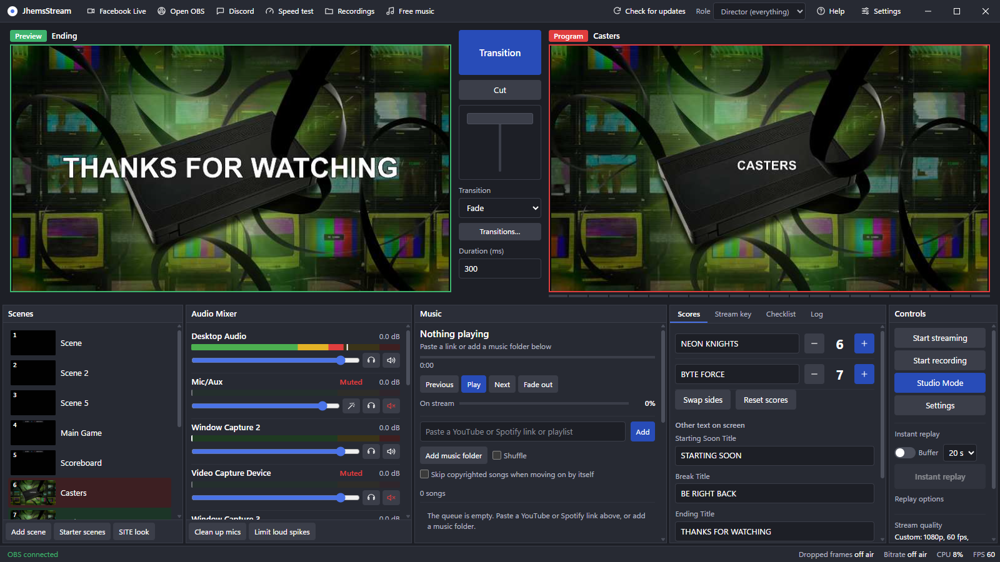
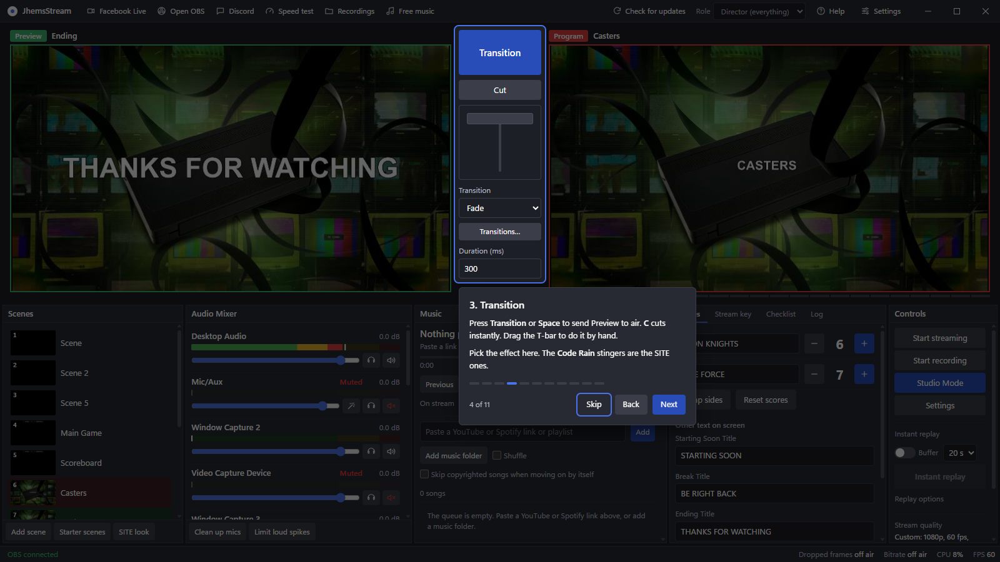
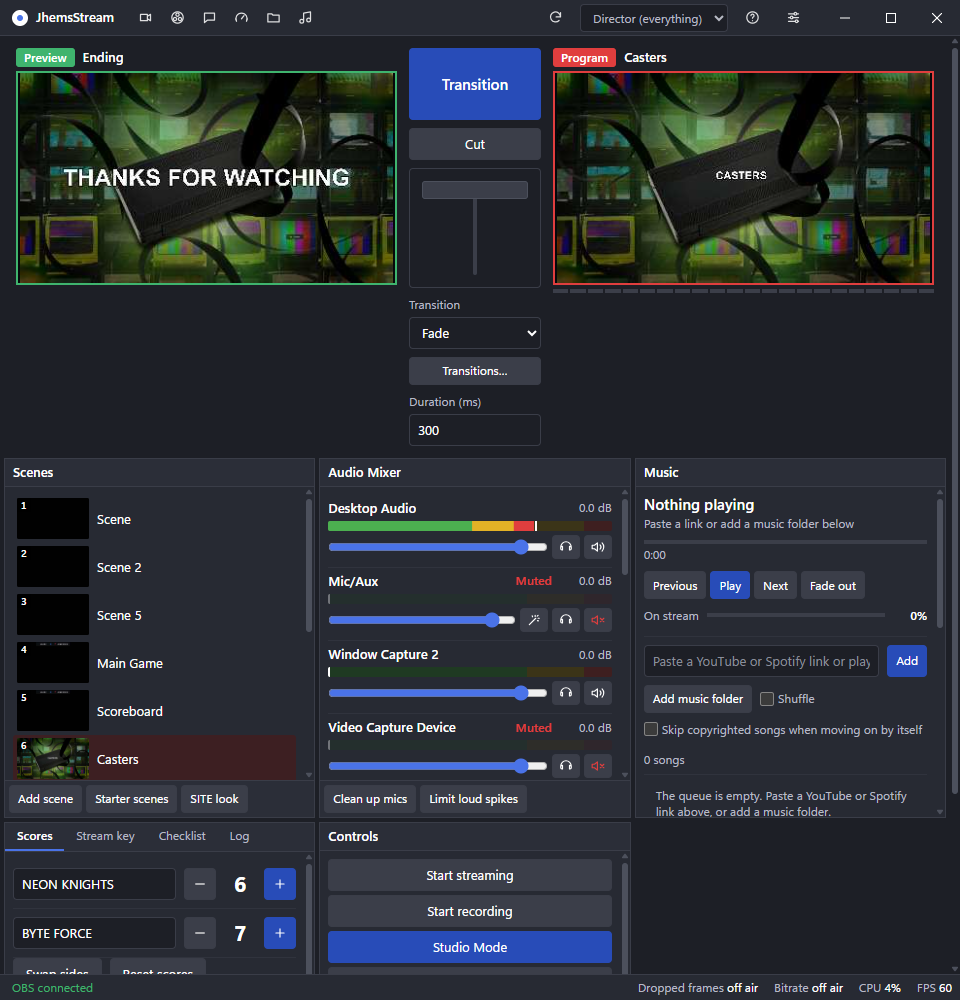
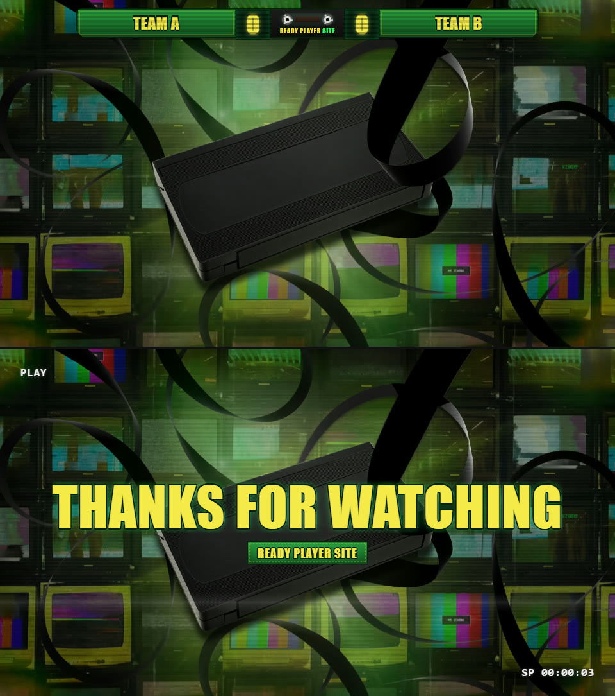
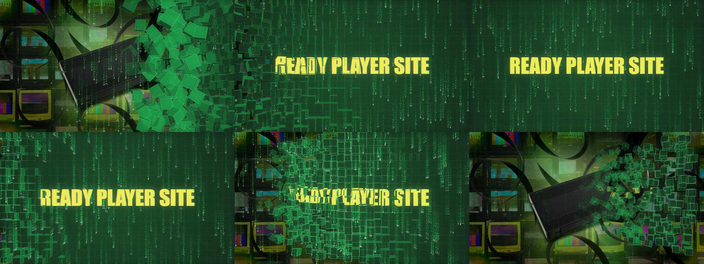
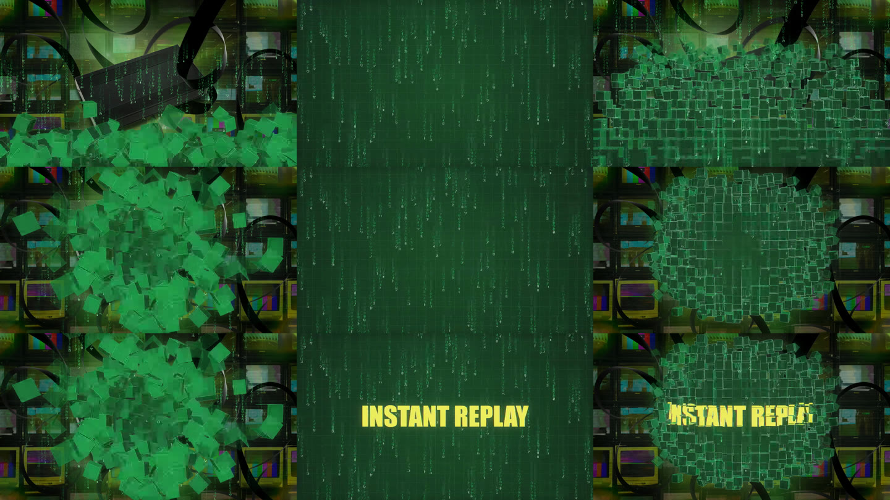

# JhemsStream

A companion control panel for OBS, built for small volunteer crews running a livestream: school org events, esports tournaments, church streams. It looks and works like a sibling of OBS, so anyone who has seen OBS feels at home, and anyone who hasn't can still run the show.

OBS does the video and sends it to Facebook (or YouTube, or Twitch). JhemsStream gives your crew Studio Mode switching, music that crossfades by itself, a scoreboard and one-click OBS setup.



## Download

Get `JhemsStream_<version>_x64-setup.exe` from [Releases](https://github.com/jherobred/JhemsStream/releases/latest) and run it. After that, the app updates itself: when a new version is out, an **Update** button appears in the menu bar.

## Features

- **Studio Mode switching**: Preview and Program side by side with live thumbnails, a Transition button, Cut, and a T-bar you can drag to transition by hand. Keys 1 to 9 pick a scene, Space transitions, C cuts.
- **One-click OBS setup** (desktop app): finds OBS, installs it with winget if it's missing, turns on its remote control, adds Swipe, Slide and Luma Wipe transitions, opens it and connects. No password typing on the streaming PC.
- **Discord screen share as a source**: pick the Discord stream window and its sound, then crop it in the scene editor.
- **Music**: a queue of local files, YouTube links and playlists, and Spotify links. Songs crossfade over a length you choose, even when someone presses Next mid-song. Music gets quieter on gameplay scenes and ducks under the casters' mics.
- **Copyright tagging**: every song is tagged as likely copyrighted, royalty-free source, or unknown, from its tags or channel. You can still play anything. Only Facebook decides what gets muted.
- **Audio tools**: mixer with live meters, fade-mute, headphone monitoring, one-click mic cleanup (noise removal, compressor, limiter) and a limiter against loud spikes.
- **Scoreboard**: team names, scores, swap sides.
- **SITE look**: one button dresses the starter screens and scoreboard in themed on-stream graphics (browser sources that follow the text the crew edits). Press it again to undo.
- **Stingers**: Code Rain transitions (a wall of voxel cubes behind falling code) from the right, left, top, bottom or bursting from the center, a titled variant, and an Instant Replay stinger, plus four simpler ones.
- **Instant replay**: OBS's replay buffer saves the last seconds, the clip loads into Preview so you can watch it first, then **Air replay** shows it and the app returns to the game when it ends.
- **Facebook Live**: a button that opens Live Producer, a field for the stream key that goes straight into OBS. JhemsStream never saves the key.
- **Crew roles**: Director, Switcher, Audio and music, Scores. Helpers on other laptops connect to the same OBS, and only the Director can start or stop the stream.
- **Settings**: dark (default, like OBS), light or system theme, compact view, and everything else in one searchable window.
- Pre-stream checklist, a guided tour that points at each part of the console, status bar with dropped frames, bitrate, CPU and FPS.

## Screens

| Guided tour | Snapped to half the screen |
|---|---|
|  |  |

On-stream graphics from **SITE look** (scoreboard and a title card over the event background):



Code Rain stinger, from cover to reveal, and the from-bottom, burst and Instant Replay versions:




## Using it from another laptop

Install the same app on the other laptop (or open `web/index.html` in a browser). On the streaming PC, open OBS, then **Tools > WebSocket Server Settings > Show Connect Info**. Enter that IP and password in JhemsStream. Both laptops must be on the same network.

## Going live on Facebook

1. In JhemsStream, open the **Stream key** tab and press **Get stream key from Facebook**.
2. In Live Producer, post as your Page, choose **Streaming software** and copy the stream key.
3. Paste it and press **Save key to OBS**.
4. Put Starting Soon on Program and press **Start streaming**. When Facebook shows the preview, press **Go live** in Facebook too.

Do a private test first with the Facebook audience set to **Only me**.

## Building from source

Needs Node 18+, Rust and the Tauri prerequisites for Windows.

```bash
npm install
npm run dev
```

Releases are built and published with `scripts/release.ps1 -Publish -Notes "<notes>"`, which signs the update with the key in `~/.tauri/jhemsstream.key` (never committed).

## How it works

The UI is plain HTML, CSS and JavaScript in `web/`, wrapped by Tauri 2 (`src-tauri/`) for the Windows app, OBS setup, per-app volume and updates. It talks to OBS through [obs-websocket](https://github.com/obsproject/obs-websocket), built into OBS 28+, using the vendored [obs-websocket-js](https://github.com/obs-websocket-community-projects/obs-websocket-js) client.

JhemsStream is an independent project and is not affiliated with the OBS Project.

## License

MIT
